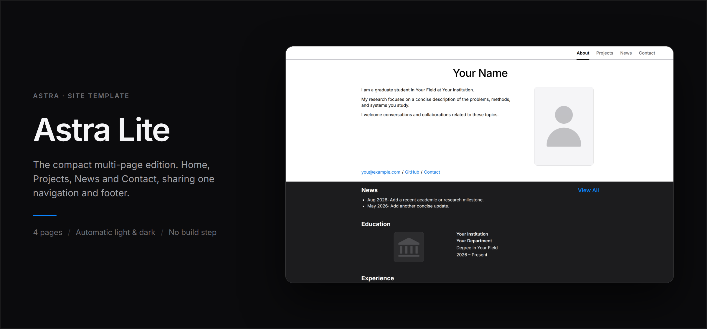
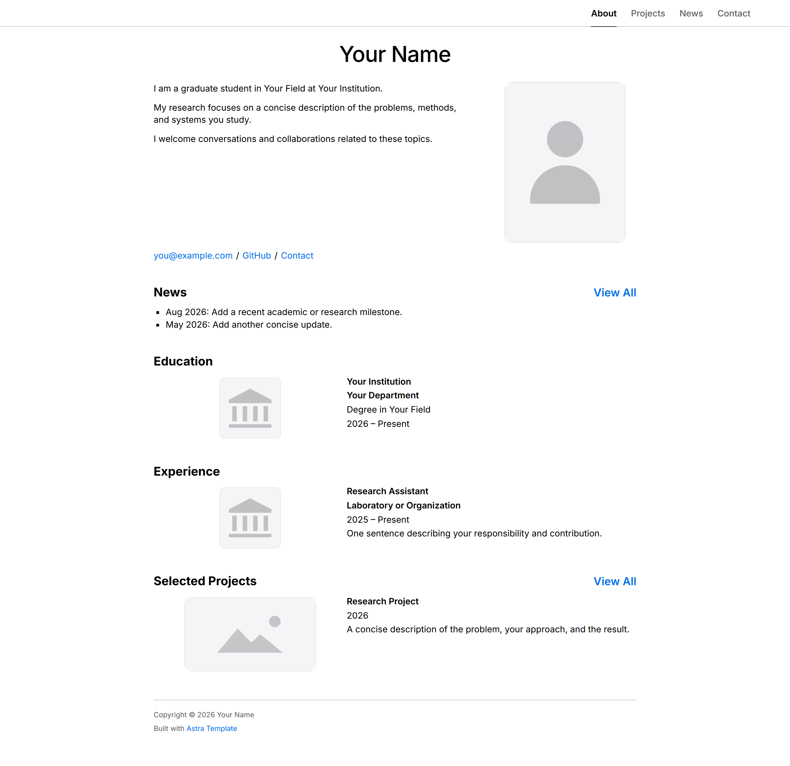
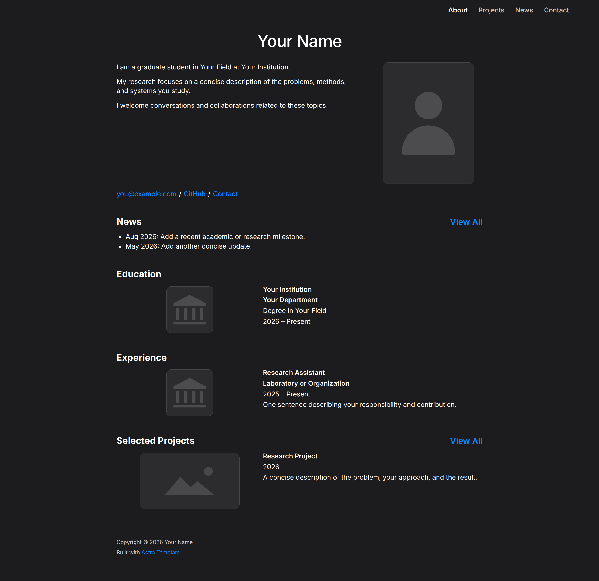

# Astra Lite



The compact multi-page edition of **Astra: Adaptive Site Template for Research
and Academia** — four pages, a shared navigation bar and a shared footer, with
no build step.

Enough structure for a homepage that has outgrown one scroll, and little enough
that the whole site still fits in your head. There is no generator, no
configuration file and nothing to keep up to date.

## Contents

- [Editions](#editions) · [Screenshots](#screenshots) · [Pages](#pages)
- [Running it](#running-it) · [Deploying](#deploying)
- [Editing](#editing) · [Theme](#theme) · [Structure](#structure)
- [Regenerating the images](#regenerating-the-images) · [License](#license)

## Editions

Astra comes in three sizes. They share one visual system — the same type scale,
spacing, colours and responsive rules — so a site can move up an edition without
being redesigned.

| | [Mini](https://github.com/yixnhuang/astra-mini) | **Lite** | [Full](https://github.com/yixnhuang/astra-full) |
|---|---|---|---|
| Pages | 1 | **4** | 17 |
| Navigation | none | **shared bar** | shared bar with grouped dropdowns |
| Theme | follows the OS | **follows the OS** | follows the OS, plus a visitor control |
| Footer | inline | **shared fragment** | shared fragment |
| Project documentation | — | — | six formats |
| Blog and RSS | — | — | yes |
| Discovery files | — | — | robots, sitemap, llms.txt, humans.txt |
| Repository | public | **public** | private |
| License | CC BY-NC-SA 4.0 | **CC BY-NC-SA 4.0** | non-commercial |

Move up to Full when you want project documentation, a blog with a feed, or a
visitor-facing theme control. Move down to Mini when one page is enough.

## Screenshots

Rendered from this repository with no content changes: Chromium, 1440 px
viewport, `deviceScaleFactor` 2, full page. Both captures use the same
unmodified sample content; only the colour-scheme preference differs.

| Light | Dark |
|---|---|
| [](docs/screenshots/home-light.png) | [](docs/screenshots/home-dark.png) |

The banner at the top is not a montage of two crops: it is one continuous page
split by a horizontal seam, light above and dark below, at the same scroll
position. See [Regenerating the images](#regenerating-the-images).

## Pages

| Page | Path | What it is |
|---|---|---|
| Home | `index.html` | Profile, education, experience, honours, selected projects |
| Projects | `projects/` | Grouped project index |
| News | `news/` | Dated entries, newest first |
| Contact | `contact/` | Addresses and academic profiles |

## Running it

```bash
git clone git@github.com:yixnhuang/astra-lite.git
cd astra-lite
python -m http.server 8000
```

Then open <http://localhost:8000>.

A local server is **required**, not a convenience: the navigation and the footer
are fetched at runtime, and `fetch` does not work over `file://`. Opening
`index.html` directly gives a page with no nav and no footer.

## Deploying

Any static host works — GitHub Pages, Cloudflare Pages, Netlify, or a plain
directory behind nginx.

**One constraint.** The navigation in `assets/js/site.js` and the footer loader
in `footer/footer.js` use root-absolute paths (`/projects/`,
`/footer/index.html`). The site therefore has to be served **at a domain root**.
Deploying to a project subpath such as `username.github.io/astra-lite/` will
break the navigation links and leave the footer empty. Serve it at a root, or
rewrite those paths to be relative.

## Editing

| To change | Edit |
|---|---|
| Page content | The `index.html` of that directory |
| Global navigation | `assets/js/site.js` |
| Footer, on every page at once | `footer/index.html` |
| Colours, type, spacing | `assets/css/style.css` |
| Breakpoint behaviour | `assets/css/responsive.css` |
| Portrait, institution logos, project thumbnails | `assets/images/*.svg` |

The three SVGs in `assets/images/` are neutral placeholders — a portrait, an
institution mark and a project thumbnail. They are there so the layout reads
correctly before you have your own images; replace them with real files of the
same aspect ratio.

## Theme

Astra Lite follows `prefers-color-scheme` and shows no theme control: the
visitor's own setting decides, and there is nothing to click. `assets/js/theme.js`
is twelve lines and listens for changes, so switching the OS to dark mode
switches the page immediately.

Colours live as custom properties on `:root` in `style.css`, with the dark set
redefined under `:root[data-theme="dark"]`. Changing the accent means changing
two values, not hunting through the file.

## Structure

```text
.
├── index.html              home
├── projects/ news/ contact/
├── footer/
│   ├── index.html          the shared footer, fetched at runtime
│   └── footer.js           the loader
├── assets/
│   ├── css/style.css       the visual system
│   ├── css/responsive.css  breakpoint behaviour
│   ├── js/site.js          navigation
│   ├── js/theme.js         follows the OS colour scheme
│   └── images/*.svg        neutral placeholders
├── docs/
│   ├── screenshots/        the README images and capture.py
│   └── brand/              showcase cards
├── LICENSE
└── README.md
```

## Regenerating the images

```bash
pip install playwright pillow numpy
playwright install chromium
python docs/screenshots/capture.py
```

The script serves the repository, loads the homepage under both colour-scheme
preferences, and writes `home-light.png`, `home-dark.png` and `hero.png`. The
banner's seam position and window height are not hard-coded: the script measures
the captured page, finds the blank gaps between sections, and puts both the seam
and the bottom edge at the **centre** of a gap, so neither ever cuts through a
line of text. Change the content and the numbers follow.

See [`docs/screenshots/README.md`](docs/screenshots/README.md) for the details
and [`docs/brand/README.md`](docs/brand/README.md) for the showcase cards.

## Project status

Maintained. Astra Lite is the compact multi-page edition of Astra.

## License

Astra is distributed under
[CC BY-NC-SA 4.0](https://creativecommons.org/licenses/by-nc-sa/4.0/) — see
[`LICENSE`](LICENSE) for the full terms. Non-commercial, so it is
source-available rather than open source.

In short:

- **You may** use Astra to build your own academic homepage, edit any of the
  content, publish the resulting site, and pass the template on.
- **You must** keep the attribution. The footer of every page carries
  `Built with Astra Template`; that line, and the notices in the source files,
  stay.
- **You must** release any template you derive from Astra under the same
  licence.
- **You may not** use it commercially: no selling it, no template marketplace,
  no paid web-design service built on it.

Building your own site with it is personal use, not commercial use, even if the
site belongs to a company you work for. Commercial use is available on request
— see [Contact](#contact).

## Contact

- Website: [yixuanhuang.com](https://yixuanhuang.com)
- Email: [yixhuang@umich.edu](mailto:yixhuang@umich.edu)
